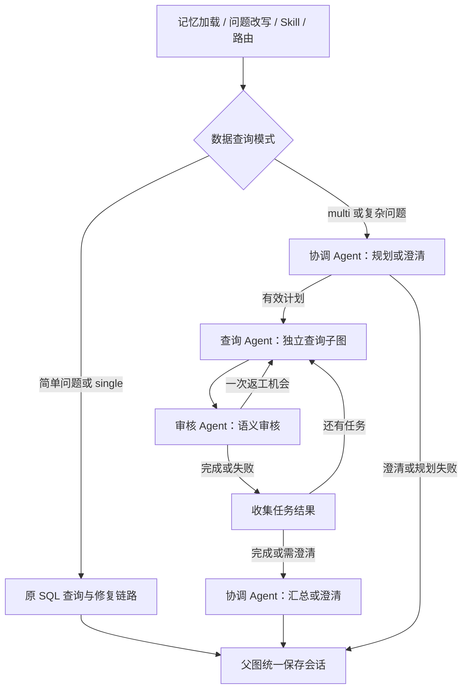

# AskData 多智能体协作：第一版

当前提供可运行的串行 Supervisor 协作流程。原单智能体链路仍可使用，无需新增依赖。

## 使用

前端输入区选择「自动选择协作模式」「单智能体」或「多智能体协作」。
CLI 使用 `/mode auto`、`/mode single`、`/mode multi`。

REST 与 SSE 请求均增加可选 `execution_mode`，默认 `auto`：

```json
{
  "question": "分别统计华东和华南地区2026年9月已支付订单的实付金额，并比较差异",
  "execution_mode": "multi"
}
```

`auto` 在意图路由为 data 后，以「分析、为什么、贡献、分别、同时、以及」等关键词保守触发协作。
关键词规则不等于可靠的任务复杂度分类器；需要复合分析时可以显式选择 `multi`。
闲聊和外部工具仍走原分支，即使指定 `multi` 也不会将其强行拆成数据库任务。

## 职责与执行流程



- 协调 Agent 读取 Schema、当前上海时间及用户偏好，产出经 Pydantic 校验的计划。
- 最多 3 个子任务，依赖只能指向前面的任务；重复 ID、循环/未知依赖、不合法计划会被拒绝。
- 查询 Agent 使用无 Checkpoint 的局部子图，复用检索、字段采样、SQL 生成、执行及修复。
- 每个查询版本默认最多执行 3 次 SQL；安全拦截直接结束该任务，不尝试绕过。
- 审核 Agent 使用独立上下文，检查 SQL 的口径、时间、关联粒度、去重和结果完整性。
- 每个任务最多语义返工 1 次；返工重新检索和生成 SQL，携带审核意见，并累积尝试与审核记录。
- 依赖失败的任务标记 skipped，独立任务继续执行。审核调用失败则标记 unverified。
- 汇总模型仅收到 approved 证据；部分成功明确标记 partial，`success=false`。
- 规划或审核可提出澄清，后续任务停止。用户在同一会话回答后，结合历史重新规划。
- 子 Agent 不写用户会话。父图在本轮结束时统一保存一组用户/助手消息及协作产物。

默认最坏情况为 3 任务 × 2 查询版本 × 3 SQL 尝试，即 18 次 SQL 生成调用，
另有最多 6 次审核、1 次规划和1次汇总，以及原有路由、改写和记忆调用。
这是调用轮数上限，不是墙钟超时或 Token/费用预算；模型请求仍使用原有客户端超时。

## 返回与展示

原字段保留。多任务没有唯一 SQL/表格，因此顶层 `final_sql`、`query_result` 为空，
顶层 `attempts` 留空，各任务的结果分别在 `task_results` 中提供：

- `collaboration_status`：single / completed / partial / failed / clarification。
- `task_plan`：口径假设、子问题、预期输出和依赖关系。
- `task_results`：task_id、question、expected_output、status、sql、query_result、
  attempts、retrieved_docs、revision、reviews、error。
- 任务最终状态：approved / failed / unverified / skipped。

前端可展开任务 SQL、表格、审核反馈和 SQL 尝试记录。
历史会话保留相同元数据，但仍受原滚动摘要机制截断旧消息的限制。
SSE 额外输出规划、查询完成、审核、返工和收集等父图节点事件；
当前页面使用 REST，尚未切换到实时 SSE 展示，子图内部也尚未逐 SQL 推送。

## 验证

在 `askdata` 环境，进入 backend 后运行：

```powershell
python -X utf8 -m unittest discover -s test -p test_collaboration.py -v
python -X utf8 test/test_graph.py
```

前端进入 frontend 后运行 `npm run build`。
协作测试使用可编程假模型和临时 DuckDB，覆盖任务交接、SQL 修复、审核返工、失败隔离、
澄清、模式切换，以及 REST/SSE 的序列化，不调用真实模型和 Embedding 服务。

## 下一阶段

1. 用真实业务问题评测单智能体与协作模式，检查模型是否遵循结构化协议以及审核误报。
2. 增加显式指标语义层和确定性的结果校验，避免多个 Agent 一致误判。
3. 提取分析 Agent，使用确定性计算工具计算差异与贡献，提供可核验的数据证据。
4. 在串行结果稳定后加入有界并行调度、总时间/Token 预算及取消传播。

审核属于辅助判断，不是授权或安全沙箱。当前 SQL 正则保护、JSON 会话存储、默认用户偏好、
内存 Checkpoint 等原有约束仍存在；本次协作改造不宣称已实现企业级权限隔离。
