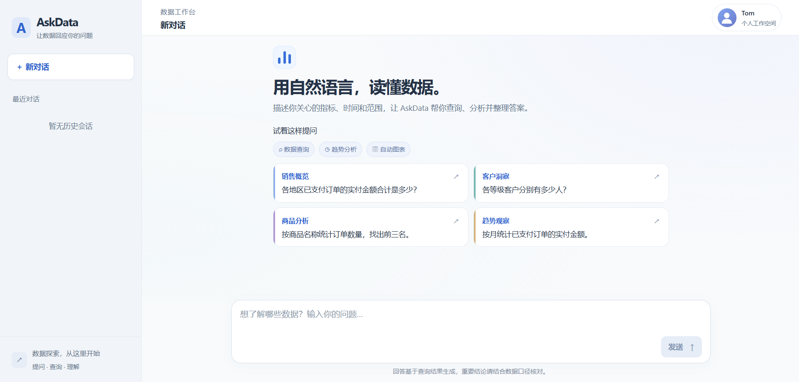
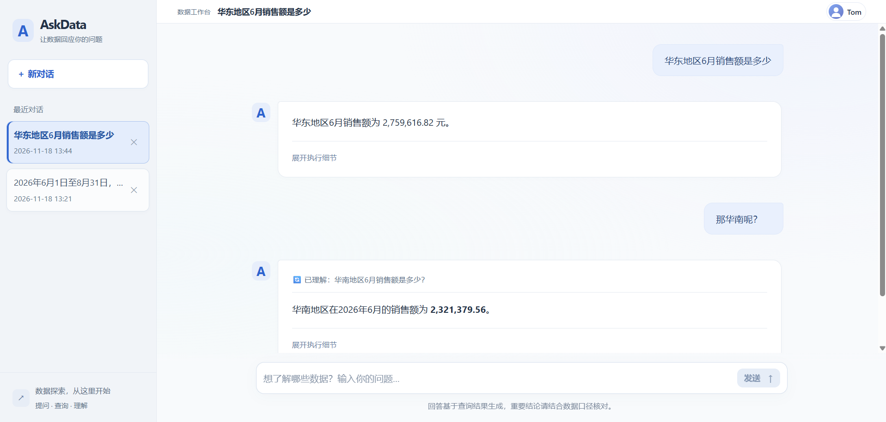
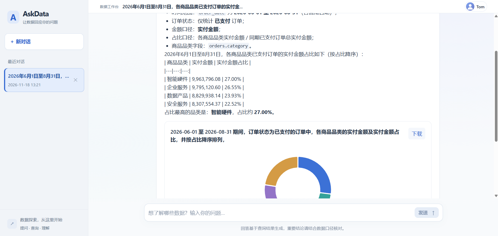
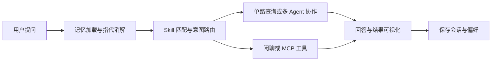

<h2 align="center">
  <br />
  <sub>AskData</sub><br />
  用自然语言，读懂数据。
</h2>

AskData 是基于 LangGraph 的自然语言数据查询 Agent，支持 DuckDB 与 PostgreSQL。通过 Schema 检索、SQL 生成、只读执行和失败修复，将业务问题转为可核对的查询结果、文字回答与可视化图表；支持多轮对话、自动选择单/多智能体路径及 MCP 工具调用。

<p align="center">
  <a href="#运行界面">运行界面</a> · <a href="#核心特性">核心特性</a> · <a href="#系统架构">系统架构</a> · <a href="#项目评测">项目评测</a> · <a href="#quick-start">快速开始</a>
</p>

## 运行界面

**开始界面**



**示例会话1**



**示例会话2**



## 核心特性

- **Schema Linking 与混合检索**：先召回候选表，再以BM25+向量检索、RRF融合召回字段，补齐合法JOIN路径和时间字段；支持纯向量、Hybrid、加权与重排等策略，重排可选本地CrossEncoder或 DashScopeAPI。
- **自动路由与有界协作**：普通查询走单智能体快速路径，明确复杂任务交由协调、查询、审核Agent串行协作；支持任务拆解、审核及有限返工。单路SQL修复耗尽仍失败时，可升级一次协作路径，避免循环切换。
- **Text2SQL与失败治理**：采样值及业务语义辅助 SQL 生成，执行报错反馈修复；模型调用支持错误分类、指数退避重试、JSON 结构化输出及不支持时的降级。
- **数据源接入与治理**：统一Connector、SchemaSnapshot和 QueryContext接入DuckDB/PostgreSQL；支持同库跨Schema、表/列 Policy、指标语义覆盖、一致只读快照和增量向量缓存。外部源默认拒绝访问，需显式授权。
- **自动结果可视化**：成功查询后按数据结构选择指标卡片、折线、柱状、排名、环形、散点或分桶直方图；规则选图不增加模型调用，前端使用 ECharts 固定模板，支持SVG下载及近期历史图表恢复。空结果、截断或不适合绘图时保留表格。
- **记忆与技能**：短期会话、滚动摘要与长期偏好共同支持多轮问答；Skill 以业务指标绑定当前数据源，缺少指标时不加载。
- **MCP 双角色**：作为 Client 调用外部工具，也可作为 Server 对外提供表列表、表结构和只读查询能力。
- **可观测与部署**：结构化日志、Prometheus指标及请求级 Trace；FastAPI提供REST/SSE，Vue3提供会话、结果表格与执行细节；Docker Compose编排前后端。

## 系统架构

### 核心编排

下图按阶段展示主流程，将具体节点合并为功能模块。



| 查询路径 | 编排过程 |
|---|---|
| 单智能体 | Schema 检索 → SQL 生成 → 只读执行；执行失败在预算内修复，耗尽后可升级一次多智能体 |
| 多智能体 | 协调 Agent 规划 → 查询 Agent 执行 → 审核 Agent 校验/返工 → 收集子任务 → 汇总回答 |
| 结果收尾 | 仅对成功单路结果或审核通过的子任务生成图表，再保存会话 |

当前用户入口自动路由，前端与 CLI 无执行模式开关，HTTP 不接受 `execution_mode`；固定模式只用于内部评测。协作细节见 [MULTI_AGENT.md](MULTI_AGENT.md)。

### 服务分层

| 层 | 职责 |
|---|---|
| Vue 3 + ECharts | 会话、文字回答、SQL、数据表、自动图表 |
| FastAPI | REST、SSE 节点进度、请求生命周期 |
| LangGraph | 记忆、路由、检索、查询、审核与可视化编排 |
| 数据源与语义层 | 授权 Schema、指标与 JOIN 定义、快照、向量缓存 |
| DuckDB / PostgreSQL | 只读查询；PostgreSQL 支持同库跨 Schema |
| 模型与工具 | OpenAI 兼容 LLM/Embedding、可选重排、MCP 工具 |


## 项目评测

评测分为业务正确性、单/多智能体配对，以及检索组件对比。

### 端到端业务正确性

覆盖联表去重、条件聚合、日期边界、排名、加权计算、多任务、澄清及多轮问答。冻结版本 `askdata-eval-v1`，LLM 为 `qwen3.8-max`。

| 数据集 | 正确/总数 | 事实/动作正确率 | 耗时 P50 / P95 |
|---|---:|---:|---:|
| 开发集 | 20/27 | 74.1% | 14.61 / 50.17秒 |
| 留出集 | 15/15 | 100% | 22.66 / 106.09秒 |

留出集字段 Recall 宏平均为96.8%，15个有执行记录的查询单元首次执行均成功，因而该轮没有测得失败修复收益。15题100%的 Wilson 95%区间为79.6%–100%。详情见 [业务评测报告](evaluation/report.md) 与 [评分协议](evaluation/README.md)。

### 单/多智能体对比

共48次执行，主指标使用20组有标准答案的配对题，澄清题单独评估；超时及服务失败计入预算内未交付。

| 模式 | 严格完成 | 复杂题完成 | 耗时 P50 / P95 | 已知输入/输出 Token |
|---|---:|---:|---:|---:|
| 单智能体 | 11/20（55%） | 1/10 | 92.0 / 98.9秒 | 34,632 / 20,928 |
| 多智能体 | 12/20（60%） | 3/10 | 122.8 / 240.2秒 | 150,871 / 88,798 |

多智能体在部分复杂题上完成更多，但成本和延迟显著增加。19/48次执行受 API 故障或预算影响；无已观察调用故障的9组配对子集中两者均为9/9，P50分别为24.3秒和81.0秒。Token总量包含澄清题且仅反映已知用量。详情见 [配对评测报告](evaluation/single-multi/report.md)。

### 混合检索与纯向量检索

检索 v2 使用40道开发题选型、16道留出题验证，包含电商目录及带相似干扰表的招聘/财务目录。各方案共享候选表筛选和结构补全。

| 留出集方案 | Recall@8 | nDCG@8 | 上下文字段覆盖 | 全字段完整率 | 检索 P50 |
|---|---:|---:|---:|---:|---:|
| 纯向量 | 96.35% | 85.35% | 96.35% | 87.50% | 15.5毫秒 |
| Hybrid | 97.40% | 85.62% | 100% | 100% | 14.4毫秒 |
| Rerank | 97.71% | 91.71% | 100% | 100% | 1680.1毫秒 |

开发集选定 Hybrid，兼顾覆盖与延迟。相对纯向量，上下文字段覆盖增加3.65个百分点；延迟基于缓存 Embedding 和已加载索引，非完整请求耗时。预选8题的真实 Agent 配对验收中，两种方案均7/8正确，均有1题模型超时，未观察到最终 SQL 正确率差异。详情见 [检索评测报告](evaluation/retrieval-v2/report.md)。

以上均为小样本项目评测；参考标注由助手编写并执行校验，缺少独立人工审计，留出集与开发集仍有业务结构和模板相关性。数据源权限、漂移等参考 SQL 重放属于工程验收，不计为模型业务准确率。

## 技术栈

| 模块 | 技术 |
|---|---|
| 编排与服务 | LangGraph、FastAPI、Uvicorn |
| 检索与重排 | BM25/jieba、Embedding、RRF、可选本地 CrossEncoder / DashScope |
| 数据访问与安全 | DuckDB、PostgreSQL、SQLGlot、表/列 Policy |
| 模型调用 | OpenAI 兼容 SDK、tenacity |
| 前端与可视化 | Vue 3、Vite 8、ECharts 6 |
| 观测与部署 | loguru、prometheus-client、JSONL Trace、Docker Compose、Nginx |

## 项目结构

```text
askdata/
├── backend/
│   ├── agent/          # 状态图、自动路由、单路查询与协作
│   ├── app/            # 模型客户端与配置
│   ├── datasources/    # Connector、权限、快照与语义治理
│   ├── retrieval/      # 表/字段召回、融合与向量缓存
│   ├── sql/            # SQL 生成、修复与安全执行
│   ├── visualization/  # 结果校验、选图规则与图表协议
│   ├── memory/         # 会话、摘要与长期偏好
│   ├── skill/          # 业务指标技能
│   ├── mcp_client/     # 外部工具接入
│   ├── mcp_server/     # 对外只读查库工具
│   ├── server/         # REST / SSE
│   ├── observability/  # 日志、指标与 Trace
│   ├── evaluation/     # 业务、检索及数据包评测运行器
│   └── data/           # 演示数据、技能、会话与缓存
├── evaluation/         # 数据集、冻结清单、运行记录与报告
├── frontend/           # Vue 界面；UI/ 存放运行截图
├── docs/assets/        # README 图标
└── compose.yaml        # 前后端容器编排
```

<a id="quick-start"></a>

## 🚀 快速开始

Docker 使用 Nginx 前端容器与 FastAPI 后端容器，支持 SSE 转发、健康检查及会话/偏好持久化挂载。准备模型配置与部署数据后，在项目根目录运行：

```bash
docker compose --env-file .env.docker up -d --build
```

打开 http://localhost:8080 。完整准备步骤、模型缓存与挂载路径见 [Docker 部署说明](DOCKER.md)。

### 环境要求

- Python 3.11（conda 环境 `askdata`）
- Node.js 24（当前前端使用 Vite 8）
- 兼容 OpenAI 协议的 LLM 服务（DeepSeek / Qwen / SiliconFlow 等均可）

### 1. 后端准备

```bash
cd backend
pip install -r requirements.txt
```

配置 `backend/.env`（参考 `.env.example`）：

```ini
LLM_BASE_URL=你的LLM服务地址
LLM_API_KEY=你的API密钥
LLM_MODEL_ID=对话模型名
LLM_EMBEDDING_MODEL=向量模型名
LLM_TIMEOUT=120
RETRIEVAL_STRATEGY=hybrid
# 可选重排：RETRIEVAL_STRATEGY=rerank
# RERANK_BACKEND=local 或 dashscope
# 本地模型：RERANK_MODEL_ID=BAAI/bge-reranker-base
# API重排另配 RERANK_API_KEY、RERANK_API_MODEL
```

首次使用且默认演示数据库不存在时，生成三张电商表、600条订单：

```bash
python data/seed_demo_data.py
```

该脚本会重建演示表；已有数据时无需重复执行。演示订单日期为2026年6月至8月，提问时建议明确指定期间。

### 2. 三种运行方式

```bash
# ① CLI 交互（终端问答）
python main.py

# ② API 服务（Swagger 文档：http://localhost:8000/docs）
uvicorn server.main:app --reload --port 8000

# ③ MCP Server 独立运行（供 Claude Code / Cursor 等外部 Agent 调用）
python mcp_server/run_server.py
```

### 3. 前端

```bash
cd frontend
npm install
npm run dev      # 打开 http://localhost:5173
```

### 4. 数据源配置

未设置 `DATA_SOURCE_FILE` 时使用默认电商 DuckDB。接入其他数据源时，复制 `backend/datasource.example.json`、`policy.example.json` 和 `semantics.example.json` 为本地配置，修改连接、授权表/列、指标口径及合法JOIN，再在 `backend/.env` 设置：

```ini
DATA_SOURCE_FILE=datasource.local.json
```

更换数据库使用新的 `source_id`。相对配置路径以 `backend/` 为基准，配置内部文件路径以该配置所在目录为基准。修改 Schema、Policy 或语义后重启后端，重建上下文与索引。[数据源治理与接入](backend/datasources/GOVERNANCE.md)。

### 5. 体验示例


| 场景 | 示例提问 |
|---|---|
| 趋势分析 | 2026年6月1日至8月31日，按月统计已支付订单的实付金额和订单数，分别展示变化趋势。 |
| 多任务分析 | 分别统计2026年6月至8月各地区已支付订单的实付金额，以及同期销售额最高的5种商品，说明统计口径。 |
| 品类构成 | 2026年6月1日至8月31日，各商品品类已支付订单实付金额分别是多少，占同期总实付金额的比例是多少？按占比降序排列。 |
| 客户分析 | 2026年6月至8月，按客户等级统计已支付订单的去重客户数、订单数和实付金额，按实付金额降序排列。 |
| 多轮追问 | 先问“2026年6月华东地区已支付订单实付金额是多少？”，再问“那华南呢？按相同口径再看7月。” |
| 工具计算 | 使用计算器，计算销售额从275万元增长到320万元的增长率，保留两位小数。 |

图表类型由结果结构及问题共同决定；空结果或不适合绘图的结果使用表格。可展开执行细节核对 SQL、子任务和审核记录。可视化能力说明见 [自动可视化](backend/visualization/README.md)。

## 参考

- [LangGraph](https://github.com/langchain-ai/langgraph)
- [Model Context Protocol](https://modelcontextprotocol.io/)
- [DuckDB](https://duckdb.org/)
- [PostgreSQL](https://www.postgresql.org/)
- [ECharts](https://echarts.apache.org/)
