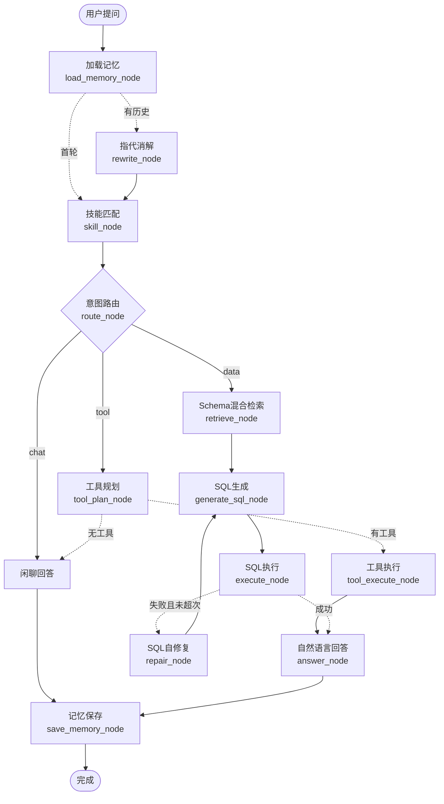

# AskData —— 自然语言数据查询 Agent

一个基于 LangGraph 的 Text2SQL 数据问答系统：用户用自然语言提问（如"华东地区上月销售额多少"），Agent 自动完成 **Schema 检索 → SQL 生成 → 只读执行 → 失败自修复 → 自然语言回答** 的全链路，并支持多轮对话记忆、技能系统与 MCP 工具生态。

> 项目动机：面向 Agent 岗位的工程实践项目，覆盖 Schema Linking、混合检索、Text2SQL 自修复、LangGraph 状态机、上下文工程、Skill、MCP 协议等 Agent 核心技术栈。

---

## ✨ 核心特性

- **字段级 Schema Linking**：为每个数据库字段生成语义文档（名称+别名+角色+描述），解决"用户说'销售额'但字段叫 paid_amount"的指代问题
- **混合检索 + 精排**：BM25（jieba 分词）+ 向量余弦检索 → RRF 倒数排名融合 → 本地 CrossEncoder（bge-reranker-base）重排
- **Text2SQL 自修复循环**：SQL 执行失败自动携带报错信息重生成（最多 3 轮），并注入字段样例值、表关联关系提升生成准确率
- **LangGraph 状态机编排**：13 个节点的状态图，条件路由（闲聊/数据查询/外部工具三路），Checkpoint 支撑多轮会话
- **双层记忆系统**：短期会话历史（滚动摘要压缩）+ 长期用户偏好（"金额默认指实付金额"），规则预筛 + LLM 提炼
- **Skill 技能系统**：可插拔技能（销售分析/客户画像），限定检索范围、注入专属指令，可与 MCP 工具联动
- **MCP 双角色**：既可作为 MCP Client 调用外部工具（calculator 演示 server），也可作为 MCP Server 对外暴露查库能力（list_tables / describe_table / query_database）
- **安全执行**：DuckDB 只读连接、DDL/DML 危险语句拦截、强制 LIMIT、采样值辅助 WHERE 生成
- **完整产品形态**：FastAPI 后端（REST + SSE 流式进度）+ Vue 3 前端（会话管理、SQL 卡片、结果表格、执行细节展示）

## 🏗 系统架构

### LangGraph Agent 状态机（核心编排图）



### 分层架构

```
┌─────────────────────────────────────────────────────┐
│  Vue 3 前端 (localhost:5173)                         │
│  会话管理 · SQL卡片 · 结果表格 · SSE流式进度展示      │
└──────────────────────┬──────────────────────────────┘
                       │ REST + SSE（Vite代理 /api）
┌──────────────────────▼──────────────────────────────┐
│  FastAPI 后端 (localhost:8000)                       │
│  /chat · /chat/stream · /sessions · /skills          │
└──────────────────────┬──────────────────────────────┘
                       │ graph.invoke / astream
┌──────────────────────▼──────────────────────────────┐
│  LangGraph Agent（13节点状态图，Checkpoint多轮）      │
│  ┌──────────┬───────────┬──────────┬───────────┐    │
│  │ 混合检索 │ SQL生成/修复│ 记忆系统 │ Skill×MCP │    │
│  │BM25+向量 │ 执行器     │ 短期+长期 │ 技能注册表 │    │
│  │RRF+rerank│ 只读安全   │ 滚动摘要 │ MCP客户端  │    │
│  └──────────┴───────────┴──────────┴───────────┘    │
└──────────────────────┬──────────────────────────────┘
                       │ 只读SQL
┌──────────────────────▼──────────────────────────────┐
│  DuckDB 演示数据库（电商：customers/products/orders） │
└─────────────────────────────────────────────────────┘
```

## 🛠 技术栈

| 层 | 技术 | 说明 |
|---|---|---|
| Agent 编排 | LangGraph | 状态机、条件路由、Checkpoint 多轮会话 |
| 模型接入 | OpenAI 兼容 SDK | LLM / Embedding 统一走 OpenAI 协议，可换任意兼容服务 |
| 混合检索 | BM25(jieba) + 向量余弦 + RRF + CrossEncoder | 稀疏/稠密两路召回，RRF 融合，bge-reranker-base 本地精排 |
| 数据库 | DuckDB | 嵌入式只读执行，零部署成本 |
| 记忆 | JSON 落盘 + LLM 摘要/提炼 | 会话历史、滚动摘要、长期偏好 |
| 工具生态 | MCP Python SDK | 同时实现 MCP Client 与 MCP Server |
| 后端 | FastAPI + Uvicorn | REST + SSE（Server-Sent Events）流式 |
| 前端 | Vue 3 + Vite | 组合式 API，fetch + ReadableStream 消费 SSE |
| 测试 | 自写脚本测试 | test/ 目录按模块覆盖 |

## 📂 项目结构

```
askdata/
├── backend/
│   ├── app/              # 模型客户端（LLM/Embedding/Rerank）、配置、数据结构
│   ├── agent/            # LangGraph：graph（图结构）、nodes（节点实现）、state（状态定义）、runtime（服务层）
│   ├── retrieval/        # store（字段文档）、service（向量索引）、ranker（BM25/RRF/混合检索）
│   ├── sql/              # generator（SQL生成/修复prompt）、executor（只读安全执行）、prompts
│   ├── memory/           # conversation（短期+滚动摘要）、long_term（长期偏好）
│   ├── skill/            # 技能注册表（扫描 data/skills/*/skill.json）
│   ├── mcp_server/       # MCP Server：对外暴露查库工具
│   ├── mcp_client/       # MCP Client：管理外部工具服务器（含 calculator 演示）
│   ├── server/           # FastAPI 层：路由、schema、lifespan
│   ├── data/             # 演示数据库、种子数据、技能定义、会话存储
│   ├── test/             # 各模块验证脚本
│   ├── main.py           # CLI 交互入口（python main.py）
│   └── requirements.in   # 依赖清单（pip-compile 管理）
└── frontend/             # Vue 3 + Vite（chat / sessions / skills 界面）
```

## 🚀 快速开始

Docker 部署步骤、F 盘存储配置和日常管理命令见 [DOCKER.md](DOCKER.md)。

### 环境要求

- Python 3.11（conda 环境 `askdata`）
- Node.js ≥ 18（验证于 v24）
- 兼容 OpenAI 协议的 LLM 服务（DeepSeek / Qwen / SiliconFlow 等均可）

### 1. 后端准备

```bash
cd backend
pip install -r requirements.txt   # 或按 requirements.in 手动安装
# 本地 rerank 模型（可选，约1.1GB）：sentence-transformers 会首次使用时自动下载
# 国内网络建议先设置镜像：export HF_ENDPOINT=https://hf-mirror.com
```

配置 `backend/.env`（参考 `.env.example`）：

```ini
LLM_BASE_URL=你的LLM服务地址
LLM_API_KEY=你的API密钥
LLM_MODEL_ID=对话模型名
LLM_EMBEDDING_MODEL=向量模型名
LLM_TIMEOUT=120
# RERANK_MODEL_ID=BAAI/bge-reranker-base   # 可选，默认即此模型
```

生成演示数据（三张电商表，600 条订单）：

```bash
python data/seed_demo_data.py
```

### 2. 三种运行方式

```bash
# ① CLI 交互（终端问答）
python main.py

# ② API 服务（Swagger 文档：http://localhost:8000/docs）
uvicorn server.main:app --reload --port 8000

# ③ MCP Server 独立运行（供 Claude Code / Cursor 等外部 Agent 调用）
python mcp_server/run_server.py
```

### 3. 前端

```bash
cd frontend
npm install
npm run dev      # 打开 http://localhost:5173
```

### 4. 体验示例

| 输入 | 触发链路 |
|---|---|
| 华东地区上月销售额是多少 | Schema检索 → SQL → 执行 → 回答（自动激活"销售分析"技能） |
| 那华南呢？ | 多轮指代消解 → 改写为完整问题 |
| 帮我计算 3*5+2 | 意图路由 → MCP 工具链路（calculator） |
| 记住：金额默认看实付金额 | 长期记忆提炼 → 后续查询自动应用 |
| 你好 | 闲聊路由，不查库 |

## 📡 API 一览

| 方法 | 路径 | 说明 |
|---|---|---|
| GET | /api/health | 健康检查 |
| POST | /api/chat | 提问，返回 answer / SQL / 表格数据 / 命中字段 / 自修复记录 |
| POST | /api/chat/stream | SSE 流式：逐节点推送执行进度与中间结果 |
| GET | /api/sessions | 会话列表 |
| GET | /api/sessions/{id} | 会话完整历史 |
| DELETE | /api/sessions/{id} | 删除会话 |
| GET | /api/skills | 可用技能列表 |

## 🧠 核心技术设计

**为什么做字段级 Schema 检索？** Text2SQL 的核心难点不是 SQL 语法而是 Schema Linking——用户的业务词（"销售额"）和物理字段名（paid_amount）对不上。把每个字段变成一条含中文标签、别名、角色（指标/维度/时间/过滤/外键）的语义文档，检索就变成了语义匹配问题；角色标注同时指导 SQL 生成（指标字段可聚合、维度字段需 GROUP BY）。

**为什么混合检索？** 向量检索对语义改写敏感（"下单日期" vs "成交日期"），BM25 对精确词面敏感，两者互补。RRF（倒数排名融合）不依赖分数量纲、无需调参即可融合两路排名，是工业界标准做法；最后用 CrossEncoder 精排（逐对打分而非单塔编码）进一步提升精度。

**为什么自修复循环？** LLM 生成的 SQL 约 10~20% 首轮执行失败（表名/别名/函数错误）。将 DuckDB 的结构化报错回喂给 LLM 重生成，配合"采样字段真实取值"（如 status 的枚举值）填充 prompt，可修复大部分错误——这是 Text2SQL 生产中成本最低、收益最高的策略。

**为什么用 LangGraph？** 流程本身可以用纯 Python 写，但 LangGraph 提供了三样难以替代的能力：① 状态机与条件路由的声明式表达（三路意图分支、失败循环）；② Checkpoint 机制让每轮对话状态天然隔离又可回溯（thread_id 多轮会话）；③ 图可视化（本项目的 mermaid 图直接由 `graph.get_graph().draw_mermaid()` 导出）。用框架的正确姿势是"先有流程，再用图组织"。

**记忆为什么分层？** 短期记忆（会话历史）解决指代消解；滚动摘要解决长对话的上下文膨胀；长期记忆解决跨会话偏好（"金额默认实付金额"）。用触发词规则预筛 + LLM 提炼，避免每轮都调用 LLM 提炼记忆浪费 token。

**Skill × MCP 怎么联动？** 技能 = 专属指令 + 检索范围 + 工具白名单；MCP 把外部工具统一成 function calling schema。技能命中时限制检索只查相关表、只暴露该技能声明的 MCP 工具——实现"按需加载能力"的 Agent 设计。

## 🧪 测试

```bash
cd backend && python -m pytest test/  # 或逐文件 python test/test_xxx.py
```

| 文件 | 覆盖 |
|---|---|
| test_retrieval.py | BM25 / 向量检索 / RRF 融合 |
| test_schema_store.py | 字段文档生成 |
| test_generator.py | SQL 生成与修复 prompt |
| test_executor.py | 只读执行、危险语句拦截、LIMIT 注入 |
| test_graph.py | LangGraph 全链路（mock 模式） |
| test_memory.py | 会话记忆、滚动摘要、长期记忆 |
| test_skill_registry.py | 技能加载与关键词匹配 |
| test_mcp_server.py | MCP Server 工具 |
| test_tool_manager.py | MCP Client 工具管理 |

## 🗺 Roadmap

- [x] 字段级 Schema 检索与向量索引
- [x] 混合检索（BM25 + 向量 + RRF + CrossEncoder 重排）
- [x] Text2SQL 最小闭环 + 自修复循环
- [x] LangGraph 状态机改造（13 节点）
- [x] 会话记忆、滚动摘要、长期偏好
- [x] Skill 技能系统 × MCP 工具生态
- [x] FastAPI 后端（REST + SSE）
- [x] Vue 3 前端
- [ ] token 级流式回答（ModelClient 接入 stream=True）
- [ ] 检索质量评测集（固定 query 集 + 命中率指标）
- [ ] Checkpoint 持久化（SqliteSaver，替代内存版）

## 📚 参考

- [LangGraph](https://github.com/langchain-ai/langgraph) —— Agent 编排框架
- [Model Context Protocol (MCP)](https://modelcontextprotocol.io/) —— Agent 工具协议
- [BGE Reranker](https://huggingface.co/BAAI/bge-reranker-base) —— CrossEncoder 精排模型
- [DuckDB](https://duckdb.org/) —— 嵌入式分析型数据库

---

开发过程记录见 [DEV_LOG.md](DEV_LOG.md)。
